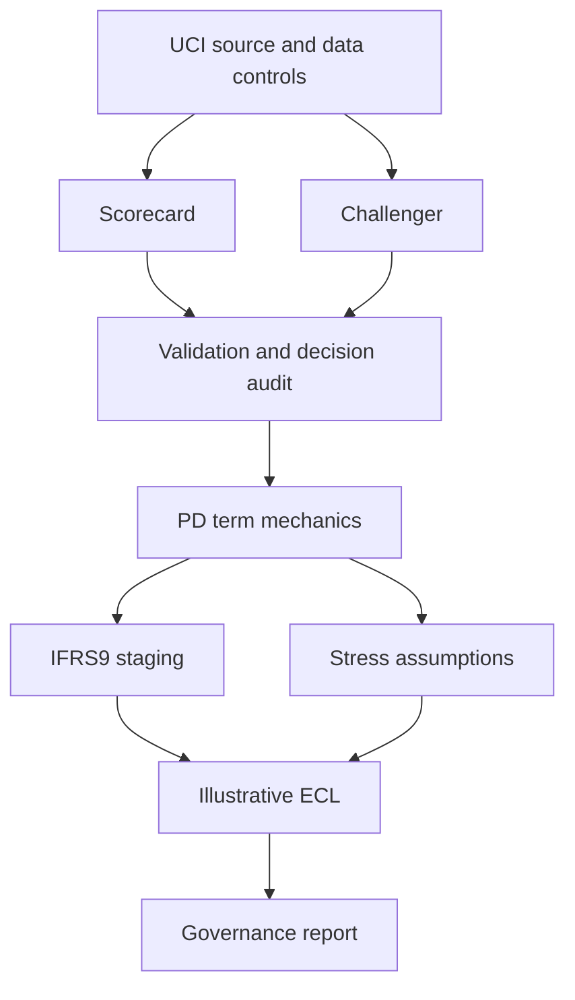

# Credit Risk, IFRS 9 & Stress Testing

## Retrospective temporal bank-risk study — October 10, 2026

**237,253 eligible FDIC bank-year observations; 57,896 final observations across 11 later annual cohorts.** Separate development, selection, calibration and monitoring-policy years, purged boundaries, nine whitelisted predictors, equal three-trial model budgets and paired bank/year uncertainty. Calibrated boosting AUC **0.9155** versus full logistic **0.8381**, but it misses **9/10 failures in the later 2022–2025 cohorts** under the frozen monitoring rule. Capital-only logistic has higher pooled AUC; calibration worsens raw probability scores. [Full results, every missed case and exact replay](docs/FDIC_TEMPORAL_REVIEW.md).

This is **bank-certificate failure using a current historical snapshot and assumed reporting lag**. It does not establish borrower out-of-time PD or original-vintage performance. `python replay_fdic_temporal.py` reconstructs all dated inputs and labels from pinned original-source extracts and verifies the frozen fit.

## Matched-budget evidence extension — October10,2026

A second public cohort adds **30,000 Taiwan credit-card records**, identical18,007-client training budgets, separate calibration/policy splits and6,001 held-out clients. Duplicate model-input groups never cross partitions. Challenger AUC0.7897 versus scorecard0.7814; Brier/cost differences remain uncertain, and calibration worsens raw test Brier. [Read the complete protocol, results and limits](docs/MATCHED_COHORT_REVIEW.md). This is one historical cohort, **not out-of-time validation**.

## Evidence release — 2026-10-09

[Paired uncertainty and decision audit](outputs/decision_audit/summary.json) · [Prior-shift scenarios](outputs/decision_audit/prior_shift_scenarios.csv) · `python audit_reference.py`

The challenger AUC difference is 0.0233 with paired 95% CI [-0.0139, 0.0613]. Its apparent advantage is uncertain, and it used more training data. The frozen validation-selected 0.17 threshold has holdout illustrative cost 133 versus reject-all 140 under 5:1 costs; this is not a demonstrated deployment improvement.

[Research scope and next extension](docs/EVIDENCE_REVIEW.md)

---

A reproducible **credit-risk modelling and validation platform** built around a traditional WoE/logistic scorecard, challenger modelling, IFRS 9-style expected-credit-loss mechanics, stress testing, monitoring and model-governance documentation.

The project is designed to demonstrate the workflow behind **PD modelling, scorecards, model validation, portfolio loss forecasting, stress testing, early-warning/risk-grade monitoring and IFRS 9 ECL architecture** without inventing empirical LGD/EAD results that the public source data cannot support.

**ECL horizon limitation:** the preserved demonstration uses an annual-ceiling approximation: Stage 1 ignores remaining maturity, while Stage 2 rounds it up to full years (including one year for zero or negative inputs). This is not exact contractual-horizon measurement or an IFRS 9-compliant provision. [Read the implemented behavior and assumptions](docs/IFRS9_METHODOLOGY.md).

## Verified headline evidence

- Holdout scorecard ROC-AUC: **0.730** (95% bootstrap CI **0.651–0.806**)
- Holdout Gini: **0.459**; KS: **0.374**; Brier score: **0.184**
- Random-forest challenger holdout ROC-AUC: **0.753**
- Holdout PSI versus development sample: **0.0392** (random-sample stability diagnostic; **not** temporal drift)
- Cost-sensitive validation threshold: **0.170**, with weighted cost **93** under the illustrative 5:1 FN/FP ratio

See [`outputs/metrics.json`](outputs/metrics.json) and [`reports/generated/model_validation_report.md`](reports/generated/model_validation_report.md) for the reproducible evidence and limitations.

## What this repository demonstrates

| Layer | Implementation |
|---|---|
| Data controls | schema/row/default-count checks, missing-value checks, deterministic stratified development split |
| Application-style PD | training-only WoE/IV transformation + logistic scorecard |
| Challenger | random-forest benchmark |
| Validation | ROC-AUC, Gini, KS, Brier, calibration intercept/slope, bootstrap AUC CI |
| Decision economics | asymmetric 5:1 false-negative/false-positive cost threshold |
| Monitoring | score PSI and PD-to-risk-grade distribution |
| IFRS 9 mechanics | Stage 1/2/3 logic, 12-month/lifetime ECL, SICR-capable staging API |
| EAD mechanics | drawn + CCF × undrawn implementation |
| Stress testing | base/downside/severe PD and LGD shocks; scenario-weighted portfolio ECL |
| Governance | model card, validation report, assumption register and production-remediation plan |
| Reproducibility | tests + GitHub Actions pipeline generating model evidence |

## Data

The empirical PD model uses the **UCI South German Credit** dataset (dataset id 522, DOI `10.24432/C5X89F`): 1,000 observations, 20 predictors, 700 good and 300 bad credits.

UCI notes that the bad-credit class was oversampled. The data also contain no dates, recovery cash flows, undrawn commitments or macro histories. Those facts drive several deliberate limitations:

- the holdout is **not** labelled out-of-time;
- LGD is an **illustrative assumption**, not an estimated recovery model;
- the dataset's credit amount is used as a drawn-EAD proxy;
- scenario weights/severities are **illustrative**, not accounting-policy calibration.

See [`data/README.md`](data/README.md) and [`docs/GOVERNANCE_LIMITATIONS.md`](docs/GOVERNANCE_LIMITATIONS.md).

## Architecture



## Run locally

```bash
python -m pip install -r requirements.txt
pytest
python run_pipeline.py
```

The pipeline regenerates:

- `outputs/metrics.json`
- `outputs/holdout_predictions.csv`
- `outputs/scorecard_feature_summary.csv`
- `outputs/stress_ecl_summary.csv`
- `reports/generated/model_validation_report.md`
- ROC, calibration and score-distribution figures

## Validation standard

The main model is intentionally interpretable. Model quality is evaluated across **discrimination, calibration, uncertainty, decision cost and stability**, rather than by accuracy alone. The challenger is retained as a benchmark to test whether added non-linearity materially improves holdout performance.

The generated validation report also states where the project stops: this is not a production underwriting model, not an accounting provision, and not a claim of empirically estimated LGD/EAD.

## Repository map

```text
src/
  data.py              UCI ingestion and controlled splitting
  woe.py               leakage-controlled WoE / IV transformer
  pd_model.py          scorecard + challenger
  validation.py        AUC/Gini/KS/Brier/calibration/bootstrap/PSI
  ecl.py               staging, EAD and lifetime-ECL mechanics
  stress.py            scenario PD/LGD shocks and portfolio ECL
  reporting.py         reproducible figures and validation report
tests/                 unit tests for ECL, validation and stress logic
docs/                  model card, IFRS 9 methodology, governance limits
data/README.md          source provenance and data-suitability assessment
run_pipeline.py         end-to-end reproducible evidence pipeline
```

## Why the limitations are part of the project

A credit-risk repository is weaker—not stronger—if it silently manufactures recovery, utilisation or macroeconomic information that the dataset does not contain. This project therefore demonstrates **model-risk judgement as well as modelling ability**: empirical claims are made only where the data support them, and the remaining components are explicitly labelled as architecture/stress assumptions.

## Evidence status

GitHub Actions validates the research source and reference results retained under `outputs/` and `reports/generated/`. The recorded successful workflows identify their exact validated source commits. Documentation-only commits may skip rerunning frozen studies; a documentation update is not a new model-validation result.
